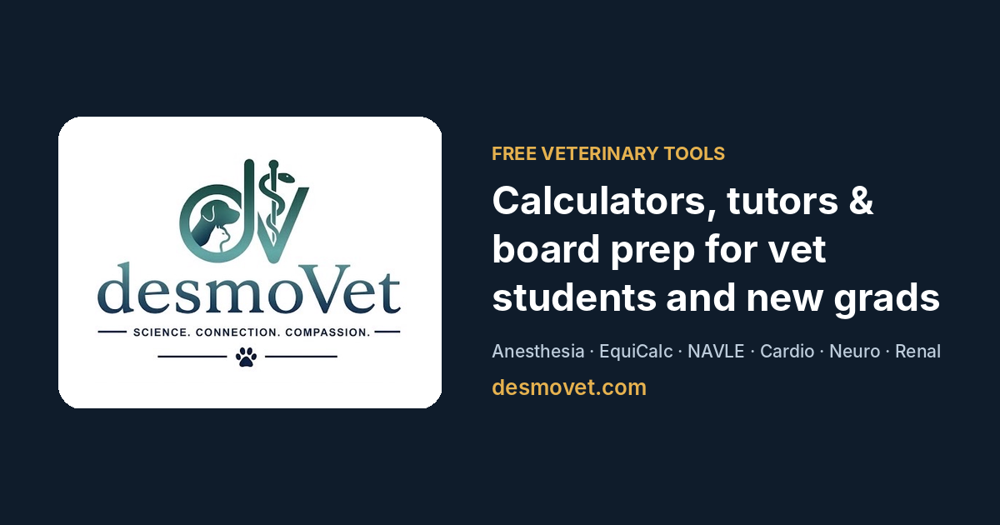

# desmoVet

**Free, interactive tools for veterinary students and new graduates.** Clinical calculators, board prep and interactive tutors, built by a veterinary student who uses them.

🌐 **[desmovet.com](https://desmovet.com)**



## Tools

| Tool | What it does |
|---|---|
| [Small Animal Anesthesia](https://desmovet.com/anesthesia/) | Dose and CRI calculator, the Kitty Magic combination, and a printable anesthetic protocol sheet |
| [EquiCalc](https://desmovet.com/equicalc/) | Equine drug and fluid calculators: GIR, TPN, fluid deficits, CRIs, induction and standing sedation |
| [NAVLE Study Hub](https://desmovet.com/navle/) | 37 chapters weighted to the ICVA blueprint and a 756-question practice bank (case vignettes, rapid recall, typed answers, 2 × 2 calculations) |
| [Bloodwork Abnormals](https://desmovet.com/bloodwork-abnormals.html) | Paste raw analyzer output and get one sentence containing only the abnormal values, ready for the record |
| [Foal Reference Ranges](https://desmovet.com/foal-reference-ranges.html) | Age-specific CBC and chemistry intervals from birth to one year, with a paste-in checker. Every interval is cited to a published table |
| [Cardio Tutor](https://desmovet.com/cardio-tutor.html) | Interactive cardiac physiology: core principles, pressure and flow, the cardiac cycle, interactive graphs |
| [Neuro Tutor](https://desmovet.com/neuro-tutor.html) | Spinal cord localization, UMN/LMN reasoning, vestibular disease, anti-seizure drugs, flashcards and cases |
| [Renal Tutor](https://desmovet.com/renal-tutor.html) | Animated nephron molecule map, glomerular hemodynamics, IRIS CKD staging with a printable client handout, and drug mechanism drills |

desmoVet also runs [free peer-tutoring matching](https://desmovet.com/tutoring.html) for first- and second-year DVM students.

## How it's built

- **Plain HTML, CSS and JavaScript.** No frameworks and no build step for the site itself. Most tools are a single self-contained file, so they are fast and easy to maintain.
- **Everything runs in the browser.** Lab values, patient weights and other inputs are processed on the page and never sent anywhere.
- **Hosted on GitHub Pages** with Jekyll, which is used only for the [articles](https://desmovet.com/articles/). Every hand-written page has no front matter and is served exactly as committed.
- **Generated, not hand-copied, where it matters.** For example, the Renal Tutor builds its drug flashcards, quiz questions and reference table from one dataset, so a correction in one place fixes all three.
- **Analytics are cookie-free** ([GoatCounter](https://www.goatcounter.com)), which counts page views without tracking individuals.

## Clinical content

Doses, intervals and cutoffs come from published veterinary sources and current consensus guidelines (for example IRIS and ACVIM). The foal reference ranges, NAVLE hub and Renal Tutor list their sources on the page, and source notes are being added to the other tools. If you find an error, please report it to **admin@desmovet.com**.

These are study and calculation aids. They do not replace clinical judgment, a current formulary, or specialist advice. Verify every dose before using it in a patient.

## Repository layout

```
index.html                  homepage
anesthesia/                 small animal anesthesia calculator
equicalc/                   equine calculator hub
navle/                      NAVLE study hub (see navle/README.md)
*-tutor.html                cardiology, neurology and nephrology tutors
bloodwork-abnormals.html    lab-report formatter
foal-reference-ranges.html  foal reference intervals
tutoring*.html, academic-integrity-policy.html   peer tutoring
_posts/, _layouts/, articles/                    articles (Jekyll)
_drafts/how-these-articles-work.md               template for writing an article
sitemap.xml, robots.txt, 404.html, og-image.png  site plumbing
```

## About

Built by **Kyle B.**, DVM candidate at Colorado State University. desmoVet is a product of KB Enterprises LLC.

© KB Enterprises LLC. All rights reserved.
